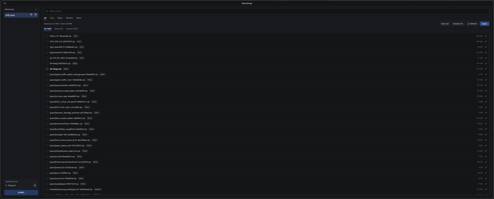

#  BeamForge

BeamForge is a mod and profile manager for BeamMP servers, written in Rust with [Slint](https://slint.dev).

It manages server mods via symbolic links, allowing you to switch between mod configurations instantly without copying large archive files or duplicating storage.

<p align="center">
  
</p>

## Features

- **Profile management**: Create, save, and switch between mod configurations (e.g. drift, rally, vanilla).
- **Symlink deployment**: Applies mods by linking directly into `Resources/Client` instead of copying files.
- **Mod indexing**: Scans archive metadata to group mods by category (cars, maps, wheels) and tracks file sizes.
- **Search & filtering**: Filter mods by title, archive name, category, or active status.
- **Server controller**: Start, stop, and monitor the BeamMP server process from the UI.

## How it works

1. **Storage**: Your central directory containing all downloaded `.zip` mods.
2. **Target (`Resources/Client`)**: The directory the BeamMP server serves to clients.
3. Applying a profile cleans outdated links in the target directory and creates symlinks only for the selected mods.

## Installation & Running

### Requirements

- Rust 1.75+ (`cargo`, `rustc`)
- System libraries: `wayland`, `libxkbcommon`, `libGL` / `mesa`, `fontconfig`

### Standard Linux (Arch Linux, Ubuntu, Fedora, Debian)

```bash
git clone https://github.com/wiensingodwieting/beamforge.git
cd beamforge
cargo run --release
```

### NixOS

```bash
./run.sh
```

### Desktop launcher (optional)

To integrate BeamForge into your desktop application menu:

```bash
./install-desktop.sh
```

## Configuration

On first run, BeamForge prompts you to set up your directory paths:

1. **Storage**: Directory containing your `.zip` mods.
2. **Server Target**: Path to `Resources/Client`.
3. **Server Script / Binary**: Path to `start-server.sh` or `BeamMP-Server`.

Paths are saved locally in `config.json` (ignored by git).

## License

GPL-3.0-or-later. See [LICENSE](LICENSE) for details.
